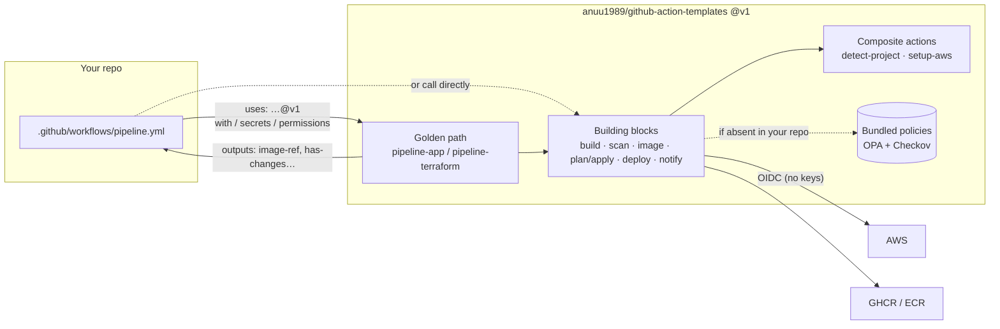

# GitHub Actions Templates

A library of production-ready **reusable GitHub Actions workflows** with examples. It covers:
- application builds (Java, Node, Python, Go, .NET)
- containers
- Terraform
- policy as code (OPA/Conftest, Checkov)
- security scanning
- AWS deployments (ECS, Lambda, S3/CloudFront, CDK, SAM, CloudFormation, EKS/Helm)
- AWS SDK automation

```
.github/workflows/     reusable workflows (on: workflow_call): golden paths + building blocks
actions/               composite actions: detect-project, setup-aws, setup-policy-tools
workflow-templates/    org starter workflows (Actions → New workflow)
scripts/               init-pipeline.sh scaffolder, AWS SDK scripts (boto3, AWS SDK for JS v3)
examples/              copy-paste caller pipelines
policies/opa/          Rego: Terraform plan (16 packages), Kubernetes (7), Dockerfile, GitHub Actions + 155 unit tests
policies/checkov/      22 Checkov custom checks (Python + YAML graph): Terraform, K8s, Dockerfile, CloudFormation
tests/                 end-to-end policy scenarios (conftest fixtures, Checkov expected results)
configs/               drop-in configs: .checkov.yaml, checkov/{dev,prod}.yaml, .tflint.hcl, .hadolint.yaml, .gitleaks.toml, labeler, dependabot
docs/                  how it works (flow diagrams), AWS OIDC setup, policy-as-code guide
```

## Quick start: one command

```bash
cd your-repo
curl -sSfL https://raw.githubusercontent.com/anuu1989/github-action-templates/v1/scripts/init-pipeline.sh | bash
```

The script detects your project (Java/Node/Python/Go/.NET app, Terraform, or anything else) and writes a
working pipeline, a security workflow and `dependabot.yml`. Options:
`--type app|terraform|security`, `--deploy none|ecs|eks-helm`, `--registry ghcr|ecr`, `--dir infra`.

Or write the caller yourself. This is the entire file for a complete application pipeline:

```yaml
# .github/workflows/pipeline.yml
name: pipeline
on: { pull_request: {}, push: { branches: [main] } }
permissions: { contents: read }
jobs:
  pipeline:
    uses: anuu1989/github-action-templates/.github/workflows/pipeline-app.yml@v1
    permissions: { contents: read, packages: write, id-token: write }
    with:
      app-name: orders-service
```

**What you get with no other configuration:**
- language and runtime version auto-detected
- build and tests
- Gitleaks and Trivy scans
- container image pushed to GHCR, with SBOM, provenance and a Trivy image scan

Add `deploy-target: ecs` (or `eks-helm`) plus an `environments` list to deploy dev → prod with approvals.
For Terraform, use [`pipeline-terraform.yml`](.github/workflows/pipeline-terraform.yml). It includes the OPA and Checkov
policies, so you don't need to copy anything.

## How it works



All jobs run as part of **your** workflow run: they use your repo's checkout, your `GITHUB_TOKEN`, only the secrets
you pass, and at most the permissions you grant. The full walkthrough, with a runtime sequence diagram, both
golden-path job graphs, policy resolution, the OIDC flow and versioning, is in
**[docs/how-it-works.md](docs/how-it-works.md)**.

### Setup checklist

1. **Reference the templates** at [`anuu1989/github-action-templates`](https://github.com/anuu1989/github-action-templates) using `@v1` (moving) or `@v1.x.y` (fixed). To use them from another org, fork the repo and replace the repo path.
2. **Allow access if the repo is private or internal:** go to **Settings → Actions → General → Access** and allow repositories in the organization.
3. **Deploying to AWS?** Set up OIDC once per account. See [docs/aws-oidc-setup.md](docs/aws-oidc-setup.md).
4. **Create GitHub Environments** (`dev`, `prod`, …) and add required reviewers to prod.
5. **Optional:** add a `SLACK_WEBHOOK_URL` secret to get notifications.

## Reusable workflow catalog

### Golden paths (complete pipelines)
| Workflow | What it does | Key inputs |
|---|---|---|
| [pipeline-app.yml](.github/workflows/pipeline-app.yml) | detect → build (auto language) → Gitleaks + Trivy (+ CodeQL) → image → ECS / EKS deploy per environment → Slack | `app-name`, `deploy-target`, `environments` |
| [pipeline-terraform.yml](.github/workflows/pipeline-terraform.yml) | static checks + Checkov → per-env plan with OPA gate and PR comment → approval-gated apply → Slack. Auto-discovers `backends/<env>.hcl` and `envs/<env>.tfvars` | `working-directory`, `environments` |
| [notify-slack.yml](.github/workflows/notify-slack.yml) | Slack webhook notification; skips silently when no webhook is set | `status`, `title` |

### Build & test
| Workflow | What it does | Key inputs |
|---|---|---|
| [java-build.yml](.github/workflows/java-build.yml) | Maven/Gradle (wrapper-aware), multi-JDK matrix, caching, test reports, artifact upload | `build-tool`, `java-versions`, `distribution`, `artifact-name` |
| [node-build.yml](.github/workflows/node-build.yml) | npm/yarn (v1 + berry)/pnpm, multi-Node matrix, lint/test/build only if scripts exist | `node-versions`, `package-manager`, `artifact-path` |
| [python-build.yml](.github/workflows/python-build.yml) | ruff, mypy, pytest + coverage, `python -m build` | `python-versions`, `run-mypy`, `build-package` |
| [go-build.yml](.github/workflows/go-build.yml) | golangci-lint, vet, race tests + coverage, static build | `build-target`, `golangci-lint-version` |
| [dotnet-build.yml](.github/workflows/dotnet-build.yml) | restore/build/test with NuGet cache, trx + coverage, publish | `dotnet-version`, `project`, `publish-project` |
| [docker-build-push.yml](.github/workflows/docker-build-push.yml) | hadolint → buildx multi-arch → GHCR/ECR/Docker Hub, GHA cache, SBOM + provenance, Trivy, cosign keyless signing | `registry`, `image-name`, `platforms`, `sign-image` → outputs `image-ref` |

### Terraform
| Workflow | What it does |
|---|---|
| [terraform-plan-apply.yml](.github/workflows/terraform-plan-apply.yml) | fmt → init (backend config) → validate → plan (`-detailed-exitcode`) → **OPA gate on plan JSON** → sticky PR comment per env → **apply the exact reviewed plan** behind a GitHub Environment |
| [terraform-static-analysis.yml](.github/workflows/terraform-static-analysis.yml) | Checks that need no credentials: fmt, validate every module, TFLint (+AWS ruleset), Trivy misconfiguration scan, terraform-docs drift |
| [terraform-drift-detection.yml](.github/workflows/terraform-drift-detection.yml) | Scheduled plan; opens, updates or closes a GitHub issue per stack |

### Policy as code & security
| Workflow | What it does |
|---|---|
| [opa-conftest.yml](.github/workflows/opa-conftest.yml) | `opa check` + `opa test` the policy library, then `conftest test` any files or a downloaded plan artifact |
| [checkov.yml](.github/workflows/checkov.yml) | Checkov for Terraform, plan JSON, CFN, K8s, Helm, Dockerfile and GHA, with custom checks and SARIF output |
| [k8s-validate.yml](.github/workflows/k8s-validate.yml) | helm lint/template → kubeconform (+ CRD catalog) → conftest |
| [codeql.yml](.github/workflows/codeql.yml) | CodeQL matrix across languages, build modes none/autobuild/manual |
| [secret-scan.yml](.github/workflows/secret-scan.yml) | Gitleaks CLI (no org license needed); scans only the PR's commits on PRs |
| [trivy-scan.yml](.github/workflows/trivy-scan.yml) | Trivy fs/config/image/repo: vulnerabilities, secrets, misconfigurations, licenses |
| [sonarqube.yml](.github/workflows/sonarqube.yml) | SonarQube/SonarCloud scan with quality-gate wait |

### AWS deployment
| Workflow | What it does |
|---|---|
| [aws-ecs-deploy.yml](.github/workflows/aws-ecs-deploy.yml) | Fetches the live task definition (or uses a file), swaps the image, deploys and waits for stability |
| [aws-lambda-deploy.yml](.github/workflows/aws-lambda-deploy.yml) | Zip or image update → publish version → move alias (instant rollback) |
| [aws-s3-static-deploy.yml](.github/workflows/aws-s3-static-deploy.yml) | S3 sync with immutable caching for assets and no-cache for HTML, then CloudFront invalidation |
| [aws-cdk.yml](.github/workflows/aws-cdk.yml) | synth; `diff` posted as a PR comment, or `deploy` |
| [aws-sam.yml](.github/workflows/aws-sam.yml) | `sam validate --lint` → build → deploy |
| [aws-cloudformation.yml](.github/workflows/aws-cloudformation.yml) | cfn-lint + Checkov → change set (optionally execute) |
| [eks-helm-deploy.yml](.github/workflows/eks-helm-deploy.yml) | update-kubeconfig → `helm upgrade --install --atomic --wait` |

## Examples

| Example | Scenario |
|---|---|
| [golden-path-app.yml](examples/golden-path-app.yml) | Entire app pipeline with ECS dev → prod in about 20 lines |
| [golden-path-terraform.yml](examples/golden-path-terraform.yml) | Terraform dev → staging → prod with bundled policies in about 20 lines |
| [java-springboot-ecs.yml](examples/java-springboot-ecs.yml) | Maven → CodeQL → ECR image → ECS dev → ECS prod (approval) |
| [java-gradle-multi-jdk.yml](examples/java-gradle-multi-jdk.yml) | Gradle library on JDK 17 + 21, SonarQube quality gate |
| [node-react-s3-cloudfront.yml](examples/node-react-s3-cloudfront.yml) | pnpm SPA → S3/CloudFront staging on main, prod on release |
| [node-api-docker-ghcr.yml](examples/node-api-docker-ghcr.yml) | Multi-arch GHCR image, cosign-signed, Trivy SARIF |
| [python-lambda.yml](examples/python-lambda.yml) | pytest/mypy → zip → Lambda dev → prod with alias |
| [go-service-eks-helm.yml](examples/go-service-eks-helm.yml) | Go → chart validation + OPA → ECR → EKS staging → prod (matrix) |
| [dotnet-ci.yml](examples/dotnet-ci.yml) | .NET build/test/publish + CodeQL C# |
| [terraform-aws-multi-env.yml](examples/terraform-aws-multi-env.yml) | Static checks + Checkov + policy tests → plan per env with OPA gate → sequential apply dev → staging → prod |
| [terraform-checkov-on-plan.yml](examples/terraform-checkov-on-plan.yml) | Scan the **plan JSON** with Checkov and OPA (resolved values) |
| [terraform-drift-nightly.yml](examples/terraform-drift-nightly.yml) | Nightly drift detection matrix → issues |
| [terraform-module-ci.yml](examples/terraform-module-ci.yml) | Module repo: docs drift, Checkov, `terraform test` |
| [security-baseline.yml](examples/security-baseline.yml) | CodeQL + Gitleaks + Trivy + Checkov (GHA) + dependency review + actionlint |
| [kubernetes-manifests-policy.yml](examples/kubernetes-manifests-policy.yml) | Raw manifests, Kustomize overlays and Dockerfile against OPA |
| [aws-cdk-app.yml](examples/aws-cdk-app.yml) | CDK diff on PR, deploy on main |
| [aws-sam-app.yml](examples/aws-sam-app.yml) | SAM dev → prod |
| [aws-cloudformation-stack.yml](examples/aws-cloudformation-stack.yml) | Change set on PR, execute on main |
| [aws-sdk-and-cli.yml](examples/aws-sdk-and-cli.yml) | Secrets Manager, SSM, boto3 multi-account report, role chaining, AWS SDK JS v3, inline `shell: python` |
| [monorepo-path-filters.yml](examples/monorepo-path-filters.yml) | Run only the changed services + a single required `ci-ok` check |
| [pr-hygiene.yml](examples/pr-hygiene.yml) | Conventional-commit PR titles, path labels, size labels |
| [release-please.yml](examples/release-please.yml) | Automated releases + publish a signed image |
| [manual-deploy-rollback.yml](examples/manual-deploy-rollback.yml) | `workflow_dispatch` deploy or rollback of any tag to any environment |
| [policy-library-ci.yml](examples/policy-library-ci.yml) | CI for a central policy repo (unit tests + scenario suites) |
| [checkov-scenarios.yml](examples/checkov-scenarios.yml) | 8 Checkov scenarios: baseline adoption, org guardrails, per-env strictness, changed files only, multi-framework, plan scan, PR comment, nightly SARIF |
| [github-actions-policy.yml](examples/github-actions-policy.yml) | Gate workflow changes with OPA (script injection, pwn requests, unpinned actions) + Checkov GHA |

## Permissions cheat-sheet

Reusable workflows can only use the permissions the **caller** grants. Set `permissions:` on the calling job:

| Need | Permission |
|---|---|
| AWS OIDC, cosign keyless signing | `id-token: write` |
| Push to GHCR | `packages: write` |
| PR comments (Terraform plan, CDK diff) | `pull-requests: write` |
| SARIF upload (CodeQL, Trivy, Checkov, Gitleaks) | `security-events: write` (+ `actions: read` for CodeQL) |
| Drift issues | `issues: write` |

## Conventions

- **No long-lived cloud keys.** Every AWS workflow uses OIDC (`aws-role-arn` input).
- **Deploy and apply jobs are bound to GitHub Environments.** Use them for required reviewers, wait timers and environment-scoped OIDC trust.
- **Inputs never go straight into `run:` scripts.** They are passed through `env:`, which protects against script injection.
- **Concurrency groups** prevent two applies or deploys to the same target at the same time, and are never cancelled mid-flight.
- **Plan once, apply that plan.** The apply job downloads and applies the reviewed `tfplan` artifact.

## Versioning & supply-chain hardening

- Consumers pin `@v1` (a moving major tag) or an exact `@v1.2.3` tag. Pushing a `vX.Y.Z` tag runs [release.yml](.github/workflows/release.yml), which creates the GitHub release and moves `vX` automatically.
- Third-party actions here are pinned to version tags for readability. For regulated environments, **pin to full commit SHAs**
  (for example with [`pinact`](https://github.com/suzuki-shunsuke/pinact) or `frizbee`) and let Dependabot keep them current ([.github/dependabot.yml](.github/dependabot.yml)).
- Consider an org-level **allow-list of actions** and requiring `@sha` pins via repository rulesets.

## Testing this repo

[`self-test.yml`](.github/workflows/self-test.yml) runs on every PR:
- `actionlint` on every workflow and example
- `opa check`, `opa test` and `opa fmt` on the policy library
- Conftest end-to-end scenarios ([tests/run-conftest-fixtures.sh](tests/run-conftest-fixtures.sh)). Pass fixtures must be clean and fail fixtures must produce every expected finding. This repo's own workflows must also pass the GitHub Actions policies.
- Checkov scenarios ([tests/run-checkov-scenarios.py](tests/run-checkov-scenarios.py)). Every custom check must exactly match its expected passed and failed resources.
- Terraform static analysis and Checkov (including the custom checks) against the example OIDC module

Locally:

```bash
opa test policies/opa -v
tests/run-conftest-fixtures.sh
python tests/run-checkov-scenarios.py
actionlint .github/workflows/*.yml examples/*.yml
checkov -d examples/terraform/github-oidc --external-checks-dir policies/checkov/custom_checks
```

## Further reading

- [How it works: flow diagrams from your workflow file to the templates](docs/how-it-works.md)
- [Starter workflows for organizations](workflow-templates/README.md)
- [AWS OIDC setup & role design](docs/aws-oidc-setup.md)
- [Policy as code guide (OPA + Checkov): full rule catalog, data-driven limits, exceptions, scenarios](docs/policy-as-code.md)
