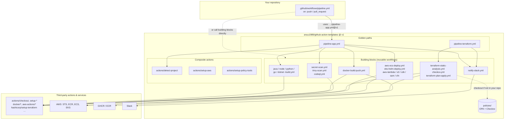
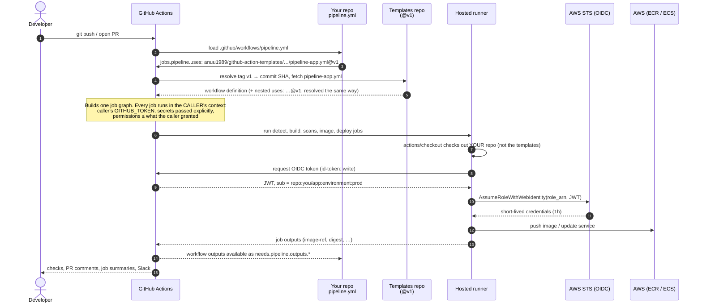
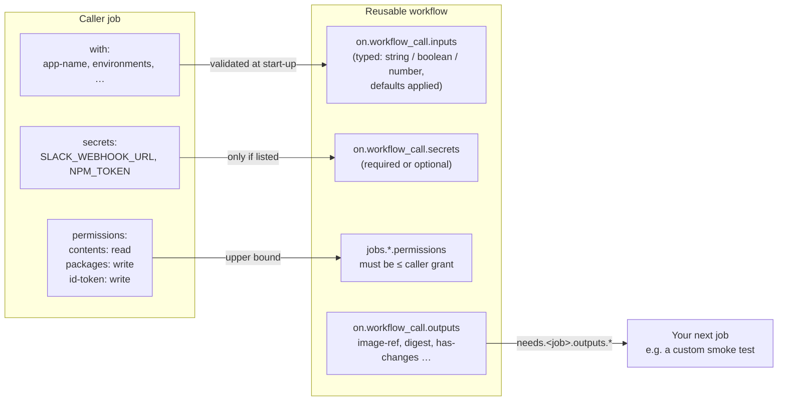
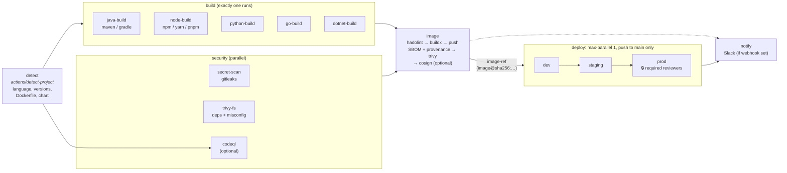
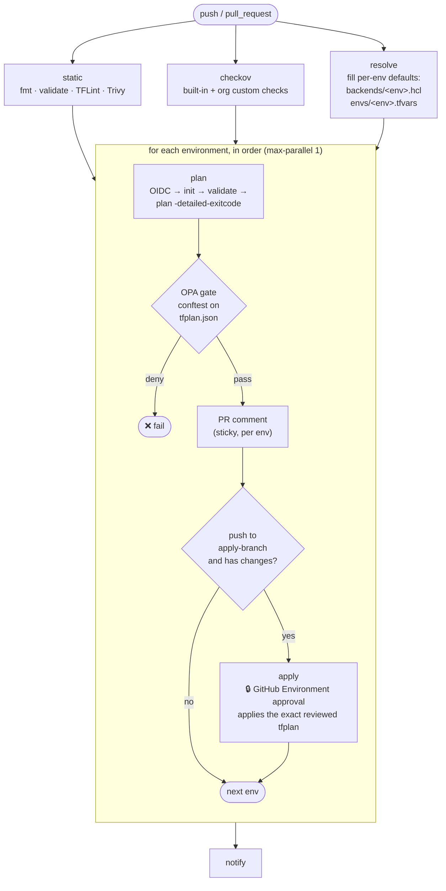
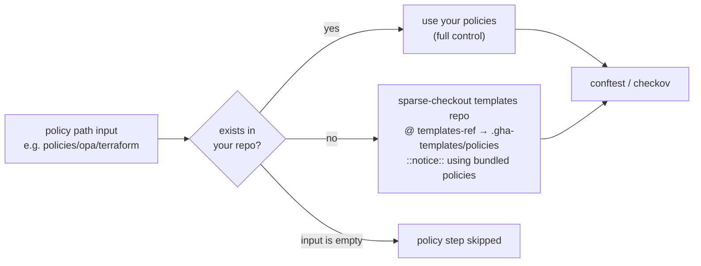
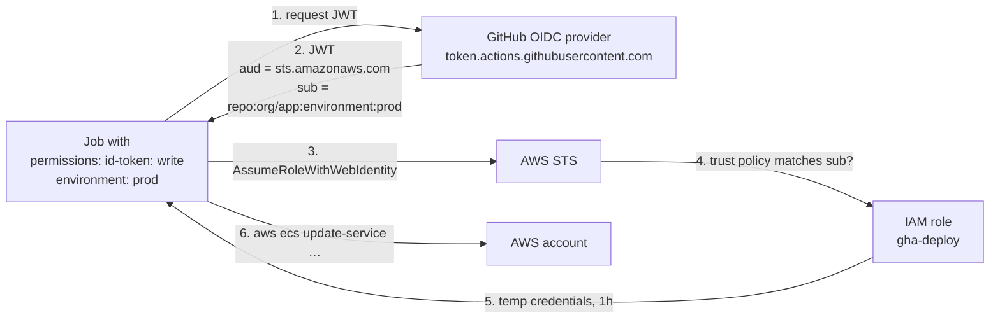
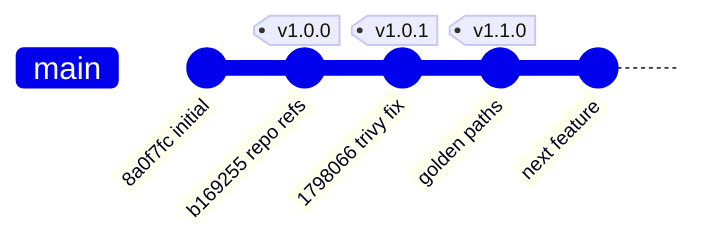

# How it works: from your workflow file to the templates

This page explains what happens when a workflow in **your repository** calls a template in
**`anuu1989/github-action-templates`**: the layers involved, how inputs, secrets, permissions and
outputs flow between them, and how a full pipeline runs end to end.

- [1. The layers](#1-the-layers)
- [2. What happens at runtime](#2-what-happens-at-runtime)
- [3. What crosses the boundary: inputs, secrets, permissions, outputs](#3-what-crosses-the-boundary)
- [4. Application golden path (`pipeline-app.yml`)](#4-application-golden-path)
- [5. Terraform golden path (`pipeline-terraform.yml`)](#5-terraform-golden-path)
- [6. Bundled policies: zero setup](#6-bundled-policies-zero-setup)
- [7. AWS authentication with OIDC](#7-aws-authentication-with-oidc)
- [8. Versioning: what `@v1` means](#8-versioning)
- [9. Getting started in one command](#9-getting-started-in-one-command)

---

## 1. The layers

You can call the templates at whichever level suits you:

| Level | What you write | Use when |
|---|---|---|
| **Golden path** | ~10 lines calling `pipeline-app.yml` / `pipeline-terraform.yml` | you want a complete, opinionated pipeline |
| **Building blocks** | a few jobs calling `java-build.yml`, `docker-build-push.yml`, … | you need a custom job graph |
| **Composite actions** | individual steps such as `actions/setup-aws`, `actions/detect-project` | you are adding steps to your own job |



---

## 2. What happens at runtime



**Key facts:**
- **One run, one job graph.** A called workflow is not a separate run. Its jobs appear inside your run, named `pipeline / build-java / Build (JDK 21)`.
- **Code checked out is yours.** `actions/checkout` inside a template checks out the *calling* repository at the triggering commit.
- **Templates never see your secrets implicitly.** They receive only what you pass under `secrets:`, and these templates never use `secrets: inherit`.
- **Nesting.** Your workflow calls a golden path, which calls building blocks: 2 levels of a maximum of 10.

---

## 3. What crosses the boundary



| Error you might see | Cause | Fix |
|---|---|---|
| `The nested job 'image' is requesting 'packages: write', but is only allowed 'none'` | caller didn't grant the permission | add it under the calling job's `permissions:` |
| `Invalid input, xyz is not defined in the referenced workflow` | typo or input not supported | check the inputs table in the template header |
| `Unable to resolve action …, unable to find version …` | tag missing upstream | pin to an existing tag or SHA (see [releases](https://github.com/anuu1989/github-action-templates/releases)) |
| `Could not assume role with OIDC` | trust policy `sub` doesn't match | see [aws-oidc-setup.md](aws-oidc-setup.md) |

---

## 4. Application golden path

`pipeline-app.yml`: **detect → build → scan → image → deploy env by env → notify**



| Trigger | detect | build | scans | image | deploy |
|---|---|---|---|---|---|
| Pull request | ✅ | ✅ | ✅ | built and scanned, **not pushed** | ❌ |
| Push to a feature branch | ✅ | ✅ | ✅ | pushed (branch tag) | ❌ |
| Push to `deploy-branch` | ✅ | ✅ | ✅ | pushed (`latest`, `sha-xxxxxxx`) | ✅ in order |
| Tag `v1.2.3` | ✅ | ✅ | ✅ | pushed (`1.2.3`, `1.2`) | ❌ (set `deploy-branch` to deploy tags) |

---

## 5. Terraform golden path

`pipeline-terraform.yml`: **static checks + Checkov → per-environment plan (with OPA gate) → approval-gated apply**



---

## 6. Bundled policies: zero setup

The policy-aware templates (`terraform-plan-apply`, `opa-conftest`, `checkov`, `k8s-validate`) look for the
policy path **in your repo first**. If it isn't there, they check out the template's own `policies/` at
`templates-ref` (default `v1`). You get the full policy library without copying anything, and can override it
whenever you like.



---

## 7. AWS authentication with OIDC



There are no stored AWS keys anywhere. Restricting the role's trust policy to `environment:prod` means only
jobs that passed the prod environment's approval rules can assume the prod role.

---

## 8. Versioning



| Reference | Moves? | Use for |
|---|---|---|
| `@v1` | yes: always the latest `v1.x.y` | most consumers: fixes and features, no breaking changes |
| `@v1.1.0` | never | strict reproducibility; Dependabot proposes upgrades |
| `@<40-char SHA>` | never | regulated environments |
| `@main` | every commit | testing unreleased changes only |

Pushing a `vX.Y.Z` tag triggers [`release.yml`](../.github/workflows/release.yml). It creates the GitHub
release and moves `vX` automatically. Breaking changes ship as `v2`.

---

## 9. Getting started in one command

```bash
cd your-repo
curl -sSfL https://raw.githubusercontent.com/anuu1989/github-action-templates/v1/scripts/init-pipeline.sh | bash
# options: --type app|terraform|security  --deploy none|ecs|eks-helm  --registry ghcr|ecr  --dir infra
```

The script detects the project type, writes `.github/workflows/{pipeline|terraform,security}.yml` and
`dependabot.yml`, and prints the remaining steps: role ARNs, GitHub Environments and an optional Slack secret.
Organizations can instead publish [`workflow-templates/`](../workflow-templates) to their `.github`
repository so the golden paths appear under **Actions → New workflow**.
